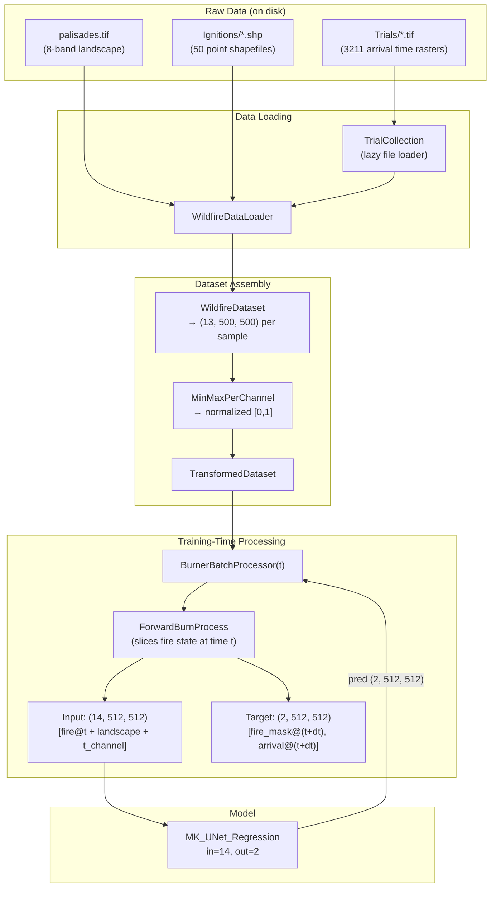

# WildfireSimulator

## Environment
```bash
conda env create -f environment.yml
conda activate wildfire_env
pip install -e .
pip uninstall torch torchvision
pip install torch torchvision --index-url https://download.pytorch.org/whl/cu126 # or thru here: https://pytorch.org/get-started/locally/
```

## Data
Data is not traditionally saved in a `.npy` file for training. Rather, `.tifs` are directly converted into the correct format for training in RAM through a DataLoader. Create a `.env` file that points to these tifs:

```bash
LANDSCAPE=/run/media/hrotovb001/9021-552E/FireDataset/palisades.tif
TRIALS=/run/media/hrotovb001/9021-552E/FireDataset/Trials/
IGNITIONS=/run/media/hrotovb001/9021-552E/FireDataset/Ignitions/
```

Currently there are 3112 samples. Each on the Palisades landscape, with parameterized:
- Ignition point (ign)
- Wind speed (ws)
- Wind direction (wd)
- Moisture (moisture)



## Run training
Simply through `python run.py`.

## Real-fire inference (infer_real.py)
`scripts/infer_real.py` runs the trained surrogate end-to-end on a **real** CAL
FIRE fire: it resolves the ignition point + reference perimeter (via the
farsite-docker `calfire_ignition.py`), ingests and resamples a LANDFIRE
landscape to fit the model's fixed 500×500 crop, drives HRRR→WindNinja
time-varying winds per autoregressive step, and rolls the model forward to
produce:
- `run_dir/results/result.json` — IoU between the predicted final polygon and
  the real reference perimeter (+ areas, cell size, crop span),
- `run_dir/spread.gif` — spread over time over a basemap + the real perimeter +
  the ignition marker,
- `run_dir/arrival_map.png` — a single fire-arrival-time map (same overlay).

The model checkpoint stores only weights; per-channel min/max are computed from
the training dataset by `scripts/compute_norm_stats.py` into an `.npz` that
`infer_real.py` reads as `model.norm_stats`.

`[simulation] start` is the **ignition** time. The model was trained on fire
states already grown to `t=dt` (~16 cells, the smallest observed state), so the
driver places the 16-cell seed **at** `start` and emits the first perimeter one
`dt` later (perimeters follow every `dt`, last at `end`). The model window is
shifted internally so the seed lands on `start`; `result.json` records the
shifted window in `start`/`end` and keeps the ignition in `ignition_date`.

Optionally set `[simulation] seed_from_real = true` (+ `real_data_root`) for an
**initialized forecast**: instead of the synthetic 16-cell disc, the model is
seeded with the real data's **first observed perimeter** (resampled onto the
crop), and the window auto-sizes so each `dt` step is **12 h** (matching the
product), anchored at the real data's first observation (`R0`). `start`/`end`
are overridden in this mode; `result.json` `ignition_date` = `R0`.

```bash
# 1. generate per-channel norm stats from the training data the checkpoint used
python scripts/compute_norm_stats.py \
  --landscape <train landscape.tif> --trials <train Trials/> \
  --ignitions <train Ignitions/> --out ./norm-stats.npz
# 2. fill configs/infer.example.toml, then:
python scripts/infer_real.py --config configs/infer.example.toml
```

Note: the pipeline deliberately drives **time-varying** wind (HRRR per hour),
which is out-of-distribution vs. training (the model only ever saw one static
wind field), so low IoU may reflect an unfair comparison — the goal is the
comparison, surfaced in `result.json`. When the 500-cell crop cannot fit the
fire at 30 m, the landscape is **resampled coarser** (logged via `resample.json`
and printed prominently); this changes the fire's effective resolution.

## Real-data spread comparison (compare_real_spread.py)
`scripts/compare_real_spread.py` optionally compares the model's **per-step**
inferred spread against a real per-step fire product (NASA FEDS perimeters on
VIIRS). It reuses a completed `infer_real.py` run and matches its fire
(`fire.json` name/year, disambiguated by the incident-number suffix, or an
explicit `--fire-id`/`--inc`) to a real-data folder
(`fires.csv` + `samples.csv` + `samples/<fire_id>.npz`). Each real-data step is
aligned to the nearest model step by real time (favoring the model slightly
ahead on ties) and scored by cell-wise IoU over the model's crop coverage.

Time is squared away: the surrogate window (`result.json` `start`/`end`) is UTC,
and the real-data `t_input`/`t_label` are the fire's **local** wall-clock time
(the dataset carries no timezone column). The adapter maps the fire's
`centroid_lon` to a nominal IANA US zone (approximate longitude bands) and
converts every real timestamp to UTC via `zoneinfo`, so the two timelines are
compared in a single (UTC) frame. The chain is anchored at the first sample that
actually holds fire (the observed perimeter above the small pre-fire
placeholder), and its **first frame is the initial observed perimeter** (the
small ignition fire) at that sample's `t_input`, with labels accumulated
afterward — so the real data's initial fire is shown rather than a large merged
first frame. It writes, into `<run_dir>/results/real_compare/` (or `--out`):

- `metrics.json` — per-step aligned IoU, average step IoU, final footprint IoU,
  and a `calfire` block giving the model and the VIIRS cumulative burned
  compared to the CAL FIRE reference on the chain window (IoU, Dice, precision,
  recall), plus the model's official polygon IoU (`model_iou_polygon`).
- `spread_compare.gif` — side-by-side real-vs-model spread per aligned step,
- `arrival_compare.png` — side-by-side first-burn (arrival) time maps,
- `combined_fat_map.png` — one map overlaying the basemap, the CALFIRE
  reference perimeter outline, the VIIRS fire-arrival raster (viridis), the
  model fire-arrival raster (YlOrRd), and the ignition point (magenta star). The
  two arrival rasters share one time scale so they are directly comparable.
- `timeline_gantt.png` — two-row timeline (surrogate model top, VIIRS data
  bottom) with every frame's timestamp plotted as a labelled marker (`M{i}` /
  `R{k}`) and a dashed connector from each VIIRS frame to the model frame it is
  aligned to (labelled with the per-pair IoU) — the FAT alignment is readable at
  a glance. A green square marks the surrogate's **ignition seed** on the model
  row (and a dotted green line marks the ignition time); the model's forecast
  window is shaded.

Only the model's raw `rollout.npz` masks are used (never the cleaned
largest-component perimeter) and only the real data's fire-spread channels. The
CAL FIRE reference perimeter is read only to draw the outline in
`combined_fat_map.png`; it is never used to compute any metric.

```bash
python scripts/compare_real_spread.py \
  --run-dir farsite-docker/FireBehaviorModels/SampleData/2025_palisades \
  --real-data /mnt/wildfire/real-data/v5_wildfires_2026-10-08
```

## Real-data baseline (train_real.py / eval_real.py)

The **real-data baseline** trains the same MK-UNet from scratch on the v5
wildfire chains (`/mnt/wildfire/real-data/v5_wildfires_*`) — no MTT trials, no
pretrained weights. It is the reference point the MTT baseline and any
fine-tune are compared against.

Everything that reads the real product lives in the **`finetune`** package
(`src/finetune/`), so `wildfire_simulator/` stays the MTT/synthetic package. The
dependency is one-way: `finetune` imports the shared MK-UNet, `shift_window`,
`iou`, `ScheduledSampler` and `ScalarRNG` from `wildfire_simulator`; nothing in
`wildfire_simulator` imports `finetune`.

| module | role |
|---|---|
| `finetune.dataset` | chains, channel selection, normalization, torch dataset, collation |
| `finetune.trainer` | scheduled-sampling training on chains |
| `finetune.infer` | full-life autoregressive rollout + the model builder |
| `finetune.metrics` | modular per-fire metric registry |
| `finetune.viz` | the three figures |
| `finetune.transforms` | per-channel z-score normalization |

Two scripts do the whole flow:

```bash
# 1. train (scheduled sampling, epoch-varying chains)
python scripts/train_real.py --config configs/real_baseline.yaml \
  --output-dir /mnt/wildfire/surrogate-model/real-baseline

# 2. metrics + visualizations on the validation split
python scripts/eval_real.py --run-dir /mnt/wildfire/surrogate-model/real-baseline \
  --real-data /mnt/wildfire/real-data/v5_wildfires_2026-10-08
```

### Throughput

Measured on this machine: 120 training fires, batch 8, 8 workers, chain length
12, one warm epoch (the first epoch of a process also pays cuDNN autotuning):

| config | s/epoch | GPU utilization (mean) |
|---|---|---|
| fp32, `cudnn.benchmark` off | 33.2 | 34 % |
| fp32, `cudnn.benchmark` on | 22.0 | 52 % |
| bf16 autocast, `benchmark` off | 153.9 | 6 % |
| bf16 autocast, `benchmark` on | 21.0 | 45 % |

Three things that table settles:

- **`cudnn.benchmark` must stay on** (it is, in `RealChainTrainer` for CUDA):
  worth 1.5x in fp32, and without it bf16 is *7x slower* than fp32 — cuDNN's
  default algorithm choice for these depthwise shapes is very poor. The price is
  a one-off autotuning pass per process, visible as a slow first epoch.
- **bf16 (`amp: true`) buys ~5 % at the epoch level**, not the 1.35x the
  isolated step loop shows, because the epoch is input-bound: the GPU is only
  running at ~45-50 % duty even with everything else in place.
- Cold disk reads at 2.3 GB/s here, so the disk is not the constraint. The
  compressed member inflate is.

Why the input side dominates — one step of a batch of 8 chains, everything
resident in GPU memory, no dataloader:

| batch | ms/step | sample-steps/s | GPU utilization |
|---|---|---|---|
| 2 | 10.5 | 190 | 49 % |
| 8 | 18.2 | 440 | 92 % |
| 16 | 33.3 | 480 | 99 % |
| 32 | 64.2 | 499 | 99 % |
| 8 + bf16 | 13.4 | 600 | 93 % |
| 16 + bf16 | 24.9 | 643 | 100 % |

So the step loop itself is healthy at batch 8 and up: the real pipeline's 0-60 %
sawtooth is starvation. The cause is the format — each fire's samples are one
**DEFLATE-compressed `npy` member** inside its npz, so *any* access to a fire
costs a full inflate of that fire, and indexed chains re-inflate it once per
chain that lands in another worker or after eviction. **Training streams fire by
fire** (`finetune.dataset.StreamingChainDataset`): each fire goes to exactly one
worker, is decompressed once, and all of its chains for that epoch are cut from
RAM.

| loader (120 fires) | s/epoch | GPU mean |
|---|---|---|
| per-chain indexing (previous) | 55.2 | 17 % |
| fire-major streaming | 30.5 | 43 % |

and with the same warm-epoch split into its two passes (fp32, nothing else on
the machine), streaming in both rows:

| storage | train pass | val pass (24 chains) | epoch |
|---|---|---|---|
| npz (inflate per fire) | 30.3 s | 9.4 s | 39.7 s |
| decompressed mirror | 24.6 s | 3.2 s | 27.8 s |

(The three storage numbers were taken in separate clean runs; earlier readings
of 108 s and 300 s for the same work came from a concurrent job on the same box
and from cuDNN autotuning being counted inside the first epoch, not from the
loader.)

Decompressions drop from one per chain (369 for those fires) to one per fire
(120) — verified directly: 4 fires / 18 chains → 4 decompressions, 14 cache
hits. Coverage is unchanged (the random back-to-back cut still moves every
epoch, `fire_chain_cuts`); the trade-off is that a batch can hold several chains
of one fire instead of a global shuffle.

Measured costs per 12-sample chain of real fires: **153 ms** through the npz
(`np.load`, i.e. pure inflate at ~270 MB/s per core) versus **26 ms** from a
memory-mapped raw array — which is what the optional
[preprocessing step](#preprocessing-optional-decompressed-sample-mirror) below
buys.

Two costs that are *not* per-epoch but will surprise you first:

- **cuDNN autotuning** (`cudnn.benchmark`, ~270 s for the bf16 shapes here) is
  paid inside the first epoch of each process: one measured warmup epoch took
  291 s while the steady-state epoch in the same harness took 22 s. Short runs
  and benchmarks should therefore warm up once and time a *later* epoch.
- **`build_val_chains`** builds one validation chain per fire, and each one needs
  that fire's array — 109 fires / 6,139 samples took **76.1 s** through the npz
  (0.32 GB/s) versus **5.6 s** through the mirror (4.35 GB/s). That is a
  once-per-launch serial cost in the parent process, before the first epoch.

### Preprocessing (optional): decompressed sample mirror

The single biggest host-side cost is that every `.npz` member is DEFLATE-
compressed, so touching a fire costs a full inflate. Measured on real fires,
building a 12-sample chain costs **153 ms** from the npz (`np.load`) versus
**26 ms** from a memory-mapped raw array — 5.9x, and the npz figure is pure
inflate (~270 MB/s of raw data per core).

`scripts/prepare_real_cache.py` decompresses the product **once** into plain
`.npy` sidecars that training memory-maps instead:

```bash
python scripts/prepare_real_cache.py \
  --real-data /mnt/wildfire/real-data/v5_wildfires_2026-10-08 \
  --out /mnt/wildfire/real-data/v5_wildfires_2026-10-08-uncompressed \
  --splits train,val,test --workers 8
# then:
python scripts/train_real.py --output-dir <run> --data-cache <out>
```

- **All 55 channels are kept**, so the mirror is a drop-in for the npz: the
  channel subset stays a training-time choice, no indexing changes, and a test
  asserts the chains built from it are bit-identical to the npz path
  (`test_decompressed_cache_is_a_drop_in_for_the_npz`). `manifest.json` pins the
  source root, the dtype and a **per-fire fingerprint (size + mtime) of the
  source npz**, so a cache built from another dataset, a mixed-dtype cache, or a
  mirror left behind by a *rebuilt* product all fail loudly at the first read
  instead of silently training on the wrong samples.
- **Effect, measured:** a 12-sample chain costs **153 ms** through the npz and
  **26 ms** through the mirror (5.9x), and the per-launch validation chain list
  (`build_val_chains`, 109 fires / 6,139 samples) costs **76.1 s** versus
  **5.6 s** (13.6x, 0.32 -> 4.35 GB/s of raw data). What is left per sample is
  chain assembly (~2 ms) rather than inflate (~13 ms), so the GPU stops waiting
  on the host.
- **Cost:** one pass, measured **120 fires / 19 GB in 8 s** with 8 workers
  (~2.4 GB/s aggregate), so the whole v5 (38,147 samples, 152 GB raw) is a
  couple of minutes. Resumable (`--overwrite` to redo, and converting another
  split keeps the other splits' fingerprints), `--limit-fires N` for a subset.
  Disk: ~149 GB for all three splits in fp32 (~102 GB train-only), or ~75 GB
  with `--dtype float16` (~1 m quantization on elevation-scale channels).
- **Wiring:** the path goes into the run's `config.resolved.yaml`, so
  `eval_real.py` reads the same mirror without being told again.

It is optional because the streaming loader already removes the *redundant*
inflates (above); the mirror removes the remaining ones.

### Resuming a run

```bash
# continue the same run: --resume with no value picks the lowest-val_loss
# checkpoint in <output-dir>/checkpoints (files are written only on
# improvement, so the best one is the most recent)
python scripts/train_real.py --output-dir <same run dir> --resume \
    --epochs 200 --early-stopping --patience 20
```

`--epochs` is the **total** target, not the number of extra epochs: resuming a
120-epoch run with `--epochs 200` trains epochs 120–199. Asking for an
`--epochs` that is not beyond the resumed epoch exits with a message rather than
silently running nothing.

What a resume restores, all of it from the checkpoint file itself:

| restored | why it matters |
|---|---|
| model weights + **optimizer state** | AdamW's moments continue; no re-warmup |
| **epoch counter** | keeps the scheduled-sampling curve where it was (self-driven by epoch 120, and a restart would drop it back to ~0.02 teacher-forcing) and keeps the per-epoch chain-cut seeds moving |
| `ModelCheckpoint.best_metric` | the first resumed epoch is not mistaken for a new best |
| `EarlyStopping.best_metric` + `epochs_since_improvement` | patience counts stalls relative to the best value of the whole run, not a fresh grace period |

The callback state rides in the checkpoint rather than in a side file, so
resuming from an older checkpoint restores *that* file's state; nothing can
drift out of sync. It is saved by `ModelCheckpoint`, which reads the state
`dict` of the callbacks listed in its `state_providers` — the script therefore
lists `EarlyStopping` **before** `ModelCheckpoint`, which is what makes the saved
patience current for the epoch being written.

TensorBoard: keep the same `--output-dir`. The new process appends an event file
to the same run directory and starts at the resumed epoch, so `Loss`, `IOU`,
`Time/epoch_seconds` and the tracked fires extend the existing series; a
different `--output-dir` forks it into a second run.

Two things to keep constant, since the checkpoint stores no config: the
effective channel list, norm stats, `model_channels` and `chain_len`. A width
mismatch fails loudly at load; a changed norm-stats path would not, so compare
against the run's `config.resolved.yaml` (which a resume rewrites — copy it aside
first if you want the phase-1 record).

### TensorBoard

Training writes to `<output-dir>/training/{train,val}`:

```bash
tensorboard --logdir /mnt/wildfire/surrogate-model/real-baseline/training
```

Every epoch: `Loss` (train/val), `IOU` (train/val) and the per-component losses
(`Loss/dice`, …) when the loss function exposes them. Every `viz_every` epochs
(default `5`; `--viz-every 0` disables) a fixed subset of `viz_fires`
validation fires is drawn — the positions are seeded, so the *same* fires are
tracked for the whole run:

| tag | content |
|---|---|
| `viz/val/fat_montage` | predicted (top) vs real (bottom) final arrival-time maps for the tracked fires, one column each, one shared hour scale — the same montage the MTT run logs |
| `viz/fire/<fire_id>/direct` | that fire's final footprint cell by cell: yellow = true positive, blue = false positive, red = false negative, gray = fire at the forecast start |
| `IOU/fire/<fire_id>` | the tracked fire's final-step IoU, so hard fires stand out of the average |

Two things to read them with in mind: the tracked chains are the *training-time*
validation chains (`val_chain_len` steps), not the full-life rollouts of the
metrics section, and the montage's colour scale is one full chain
(`chain_len × 12 h`), so a fire whose window ends before it stops burning never
reaches red.

### Data contract

One 12-hour sample per step, 135×135 windows (see the dataset's `README.md` and
`ROLLOUT.md`). `finetune.dataset` reads the product directly and
builds **chains**: a contiguous run of samples laid out in its *start* sample's
window, with every later sample's inputs and labels shifted into that window
(`row0`/`col0` make the shift exact) and cells no window covers left as NaN
inputs and unscored. Per step it stores the state *before* the step, that step's
own meteorology/terrain/time, the cumulative burned truth, and the scorable
cells; the satellite-observation channels (`frp`, `n_detections`,
`new_fire_pixels`) are zeroed from step 1 on, because a forecast does not have
them.

| item | value |
|---|---|
| channels (default) | every channel in `channels.json` except `fbfm_mode` = 54. `fbfm_mode` is the one channel the product ships without normalization statistics, and it is a *nominal* FBFM40 code (32 codes between 91 and 189 in a 6-fire sample), so z-scoring it would invent distances between fuel classes. The seven `fbfm_*` composition channels carry its *group* — the code's group matches `argmax` of those fractions in 96.7 % of 12.1 M cells — but 32 codes collapse into 7 groups, so the within-group detail is not in the default input; include `fbfm_mode` explicitly (with statistics, or one-hot encoded) if you want it |
| model input | those 54 channels + one step-time channel (`hours / 24`) = **55** |
| normalization | `norm_cache/04c547cd280a3e4d.json` z-scores, `log1p` for the channels flagged `log` |
| static channels | read from the chain's start window (one landscape per fire), so terrain is never mean-filled |
| chain seed | the fire's first sample whose perimeter exceeds the 20-cell pre-fire FEDS placeholder |
| architecture | the MK-UNet body/widths of the MTT surrogate (`channels=[16,32,64,96,160]`), input stem widened to 55 channels, one sigmoid mask output (0.33 M params, same as the MTT checkpoint) |

Training follows `ROLLOUT.md`: each epoch every fire is cut into back-to-back
12-step (6-day) chains from a random start, plus a 50 % chance each of a chain
from the fire's first real sample and from a growing step; a step is given the
model's own forecast with probability `1/(1+exp(-k*(epoch-t0)))` (teacher-forced
early, half and half at `t0`, self-driven late); no gradient flows back through
the mask handed to the next step; burned land never unburned. Validation during
training is one deterministic 12-step chain per val fire, reported as `val_loss`
(checkpoint selection) and `val_iou`.

### Metrics (modular)

Each fire is rolled forward from its first observed perimeter to the end
of its recorded life, then scored per fire. Four metrics are reported by
default:

- **`final_iou`** — the final model footprint against the fire's final burned
  footprint (every perimeter unioned to the last timestep),
- **`avg_step_iou`** — mean per-step IoU over the whole rollout,
- **`precision_final`** — of the cells the model calls burned at the end, the
  fraction that really burned,
- **`recall_final`** — of the cells that really burned, the fraction the model
  found.

The precision/recall pair is there because `final_iou` alone is ambiguous: once
the predicted union engulfs the fire, IoU degenerates into a ratio of true to
predicted area, so a long rollout looks "worse" purely because its truth is
small. Reported together, the pair separates over-prediction (precision
collapses, recall stays high) from missed spread (the reverse).

All four are averaged over the validation set and written to
`<out>/metrics.json` (+ `<out>/per_fire.csv`). Evaluation is **deterministic**:
`eval_real.py` disables cuDNN autotuning and enables deterministic kernels,
because a timing-based convolution-algorithm choice otherwise flips cells whose
probability sits at the 0.5 mask threshold — measured at 43 of 109 val fires, up
to ±153 cells and 0.014 IoU per fire, while the set-wide mean moved only 4e-4.
With the pin, two invocations of the same checkpoint reproduce `per_fire.csv`
exactly. Training keeps autotuning on (it is a speed win) and does not claim
bit-reproducibility.

Other registered metrics slot in
with `--metrics name,name` (or `--metrics all`): `median_step_iou`,
`dice_final`, `growth_ratio`, `persistence_final_iou`, `arrival_mae_hours`. Add
one without touching the script:

```python
from finetune import metrics as rm

@rm.register_metric("my_metric", "what it measures")
def _my_metric(rollout: rm.FireRollout) -> float:
    ...
```

Absolute IoU alone is a weak signal on this product (a large fire filling the
window scores high even when it is mostly false positives, and 60 % of samples
have exactly zero growth), which is why the precision/recall,
`persistence_final_iou` and `growth_ratio` companions are one flag away.

### Visualizations

Per fire, all over the elevation under the fire (from the real data's `elev`
channel — no basemap or API call), for a seeded sample of fires
(`--num-visuals`, default 5) or one named fire
(`--fire-name "Claremont" --year 2020`, or `--fire-id`):

| file | content |
|---|---|
| `final_arrival_comparison.png` | real vs predicted fire arrival time on terrain, `YlOrRd` on one shared hour scale (start of the fire yellow → end red) |
| `wind_coherence.png` | the same pair with the rollout-mean wind (terrain-adjusted `wn_*`, else HRRR `u10/v10`) as a quiver field |
| `direct_comparison.png` | final real vs predicted footprint cell-by-cell: yellow = true positive, blue = false positive, red = false negative, gray = the fire already burning at the forecast start |

```
<out>/
  metrics.json            # config, per-fire metrics, summary, per_fire_extra, figures
  per_fire.csv            # one row per scored fire
  duration_metrics.png    # from plot_duration_metrics.py (below)
  fires/<name>_<fire_id>/
    final_arrival_comparison.png
    wind_coherence.png
    direct_comparison.png
```

### Aggregate analysis: metric vs fire length

`scripts/plot_duration_metrics.py` turns an evaluation directory into one figure
and a printed table: each metric's **median over quantile bins of fire length**,
with the inter-quartile range as the bar. It deliberately draws no per-fire
scatter — 100+ points overplot into noise, and the bins carry both the trend and
the spread.

```bash
python scripts/plot_duration_metrics.py --run-dir <run dir>       # uses run/real_eval
python scripts/plot_duration_metrics.py --eval-dir <run>/real_eval --bins 8
```

Default series are `avg_step_iou`, `precision_final`, `recall_final`; `--metrics`
takes any columns `per_fire.csv` has (so re-run `eval_real.py --metrics all`
first if you want others). `final_iou` is available but not plotted by default:
once the predicted union engulfs a fire it degenerates into a ratio of true to
predicted area, which the precision/recall pair explains directly. On the
109-fire v5 validation set the shape is: step IoU declining gently, precision
peaking at mid durations and collapsing on the longest fires (~0.13 beyond 100
steps) while recall climbs to 1.00 — the model progressively filling the window.

Useful flags: `--split-key val|train|test|all` (default `val`), `--max-fires N`,
`--metrics-only`, `--vis-only`, `--limit-fires N` (training smoke test),
`--chain-len`, `--batch-size`, `--num-workers`, `--epochs`, `--amp/--no-amp`,
`--data-cache DIR`, `--device`.

Note: `wildfire_simulator` and `finetune` must be importable — the scripts add
`src/` to `sys.path` themselves, and `pytest` needs `PYTHONPATH=src` (or a
`pip install -e .`) when the environment's editable install points elsewhere.
