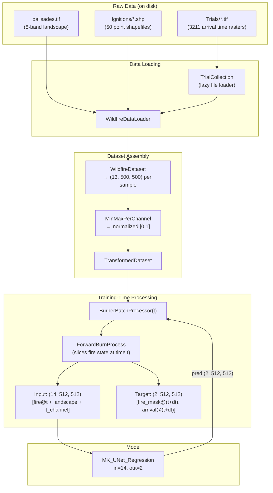

# WildfireSimulator

## Environment
```bash
conda env create -f environment.yml
conda activate wildfire_env
pip install -e .
pip uninstall torch torchvision
pip install torch torchvision --index-url https://download.pytorch.org/whl/cu126 # or thru here: https://pytorch.org/get-started/locally/
```

## Data
Data is not traditionally saved in a `.npy` file for training. Rather, `.tifs` are directly converted into the correct format for training in RAM through a DataLoader. Create a `.env` file that points to these tifs:

```bash
LANDSCAPE=/run/media/hrotovb001/9021-552E/FireDataset/palisades.tif
TRIALS=/run/media/hrotovb001/9021-552E/FireDataset/Trials/
IGNITIONS=/run/media/hrotovb001/9021-552E/FireDataset/Ignitions/
```

Currently there are 3112 samples. Each on the Palisades landscape, with parameterized:
- Ignition point (ign)
- Wind speed (ws)
- Wind direction (wd)
- Moisture (moisture)



## Run training
Simply through `python run.py`.

## Real-fire inference (infer_real.py)
`scripts/infer_real.py` runs the trained surrogate end-to-end on a **real** CAL
FIRE fire: it resolves the ignition point + reference perimeter (via the
farsite-docker `calfire_ignition.py`), ingests and resamples a LANDFIRE
landscape to fit the model's fixed 500×500 crop, drives HRRR→WindNinja
time-varying winds per autoregressive step, and rolls the model forward to
produce:
- `run_dir/results/result.json` — IoU between the predicted final polygon and
  the real reference perimeter (+ areas, cell size, crop span),
- `run_dir/spread.gif` — spread over time over a basemap + the real perimeter +
  the ignition marker,
- `run_dir/arrival_map.png` — a single fire-arrival-time map (same overlay).

The model checkpoint stores only weights; per-channel min/max are computed from
the training dataset by `scripts/compute_norm_stats.py` into an `.npz` that
`infer_real.py` reads as `model.norm_stats`.

```bash
# 1. generate per-channel norm stats from the training data the checkpoint used
python scripts/compute_norm_stats.py \
  --landscape <train landscape.tif> --trials <train Trials/> \
  --ignitions <train Ignitions/> --out ./norm-stats.npz
# 2. fill configs/infer.example.toml, then:
python scripts/infer_real.py --config configs/infer.example.toml
```

Note: the pipeline deliberately drives **time-varying** wind (HRRR per hour),
which is out-of-distribution vs. training (the model only ever saw one static
wind field), so low IoU may reflect an unfair comparison — the goal is the
comparison, surfaced in `result.json`. When the 500-cell crop cannot fit the
fire at 30 m, the landscape is **resampled coarser** (logged via `resample.json`
and printed prominently); this changes the fire's effective resolution.

## Real-data spread comparison (compare_real_spread.py)
`scripts/compare_real_spread.py` optionally compares the model's **per-step**
inferred spread against a real per-step fire product (NASA FEDS perimeters on
VIIRS). It reuses a completed `infer_real.py` run and matches its fire
(`fire.json` name/year, disambiguated by the incident-number suffix, or an
explicit `--fire-id`/`--inc`) to a real-data folder
(`fires.csv` + `samples.csv` + `samples/<fire_id>.npz`). Each real-data step is
aligned to the nearest model step by real time (favoring the model slightly
ahead on ties) and scored by cell-wise IoU over the model's crop coverage. It
writes, into `<run_dir>/results/real_compare/` (or `--out`):

- `metrics.json` — per-step aligned IoU, average step IoU, final footprint IoU,
- `spread_compare.gif` — side-by-side real-vs-model spread per aligned step,
- `arrival_compare.png` — side-by-side first-burn (arrival) time maps,
- `combined_fat_map.png` — one map overlaying the basemap, the CALFIRE
  reference perimeter outline, the VIIRS fire-arrival raster (viridis), the
  model fire-arrival raster (YlOrRd), and the ignition point (magenta star). The
  two arrival rasters share one time scale so they are directly comparable.

Only the model's raw `rollout.npz` masks are used (never the cleaned
largest-component perimeter) and only the real data's fire-spread channels. The
CAL FIRE reference perimeter is read only to draw the outline in
`combined_fat_map.png`; it is never used to compute any metric.

```bash
python scripts/compare_real_spread.py \
  --run-dir farsite-docker/FireBehaviorModels/SampleData/2025_palisades \
  --real-data /mnt/wildfire/real-data/v5_wildfires_2026-10-08
```
